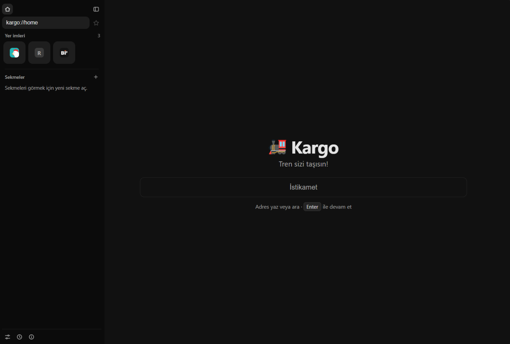
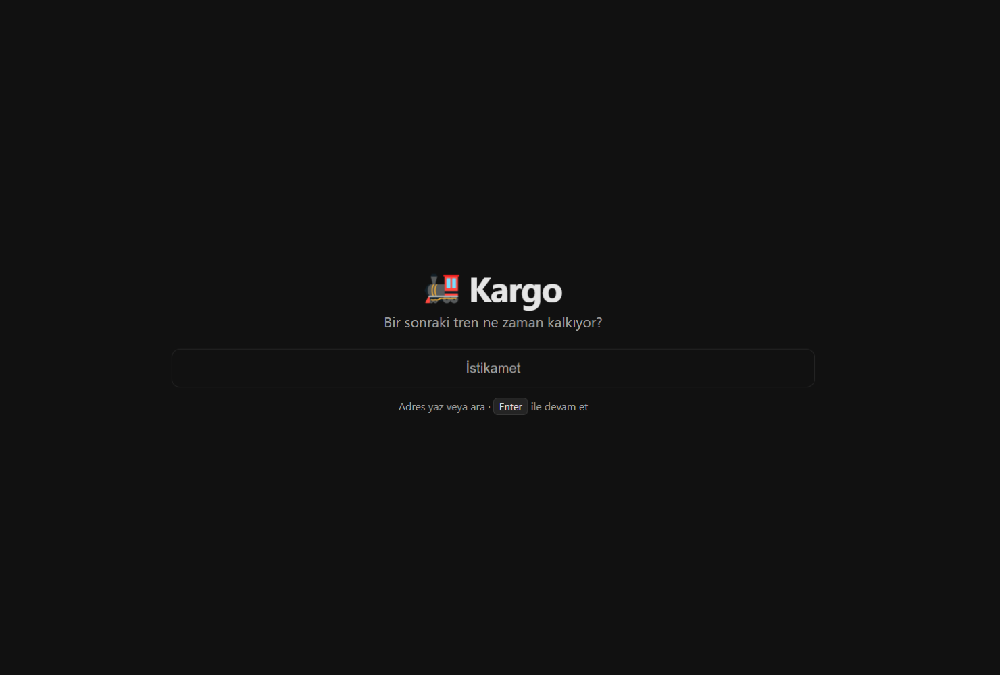
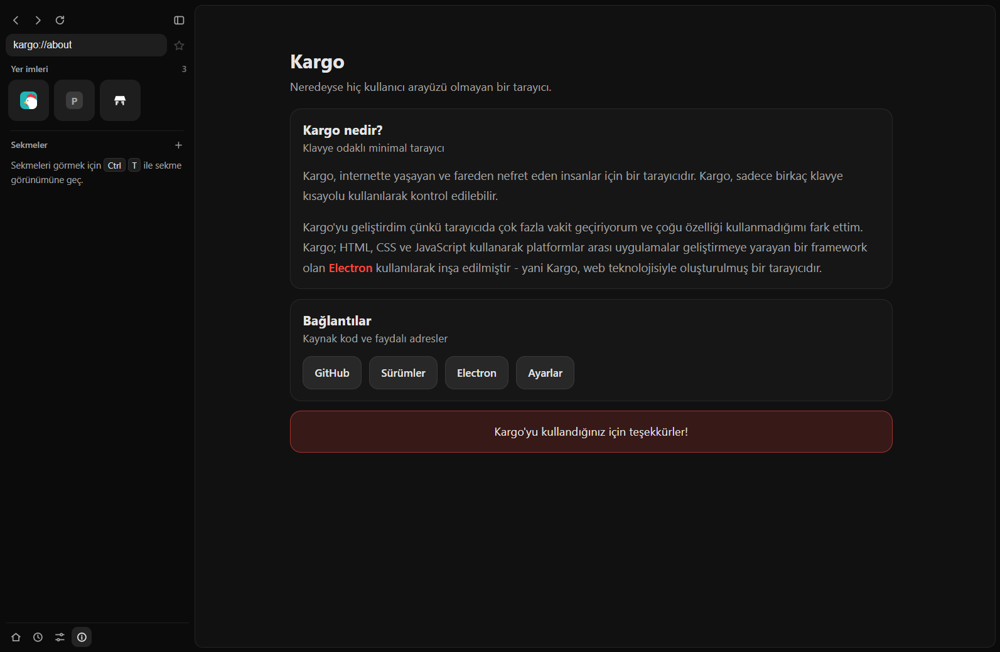

  
  <h1 align="center">Kargo</h1>

  Neredeyse hiç kullanıcı arayüzü olmayan bir tarayıcı.

Kargo, internette yaşayan ve fareden nefret eden insanlar için bir tarayıcıdır. Kargo, sadece birkaç klavye kısayolu kullanılarak kontrol edilebilir. Kargo, bir tarayıcının sadece en kullanışlı özelliklerini içerir; bu sayede internette gezinirken gereksiz özellikler sizi rahatsız edemez. Kargo'yu geliştirdim çünkü tercih ettiğim tarayıcıların (Chrome ve Firefox) sahip olduğu çoğu özelliği kullanmıyordum.

Kargo henüz çok erken aşamadadır ancak şimdiden kullanılabilir durumdadır; lütfen geliştirmeme yardımcı olun.

Denemek veya yüklemek için önceden derlenmiş [sürümlerimizden (binaries)](https://github.com/aardaakpinar/kargo/releases/latest) birini kullanabilirsiniz.

## Özellikler

- **Chrome**: Kargo, gücünü Chromium'dan alan Electron'un webview etiketlerini kullanır.
- **Kenar çubuğu**: Zen gibi sol tarafta kompakt bir kenar çubuğu; sekmeler ve yer imleri orada durur. Gizlediğinde sol kenara gelince yüzen panel olarak açılır.
- **Yer imleri**: `Ctrl + D` ile sayfayı ekle/kaldır, kenar çubuğunda sürükleyerek sırala, ana sayfada hızlıca eriş.
- **Geliştirici Araçları**: Kargo, Chrome'un geliştirici araçlarını tam olarak destekler.
- **Platformlar arası**: Kargo tüm platformlarda iyi görünür, Windows'taki başlık çubuğu bile şık durur.
- **Basit**: Kargo sadece çoğu insanın ihtiyaç duyduğu özelliklere sahiptir.
- **Sekme Kurtarma**: Kargo, açıldığında önceden açık olan sekmelerinizi otomatik olarak geri yükler.
- **Çok şirin**: 🚂🚋🚋 Kargo (web'i evinize taşır).

## Ekran Görüntüleri

##### Windows üzerinde Kargo ana sayfası

##### Windows üzerinde Kargo Kompakt Mod

##### Windows üzerinde Kargo hakkında sayfası

## Klavye Kısayolları

https://aardaakpinar.github.io/kargo/#shortcuts

Kısayolları **Ayarlar → Kısayollar** bölümünden değiştirebilirsin: bir kısayola tıklayıp yeni tuş kombinasyonuna bas. `Esc` kaydı iptal eder, `↺` tek kısayolu, "Varsayılanlara dön" ise tümünü sıfırlar. Tüm kısayollar `Ctrl` ile başlar; yalnızca `F5` ve `F12` bu kuralın dışındadır.

## Gelecek

Kargo hala geliştirilme aşamasındadır, ancak hayallerimizdeki tarayıcıyı yapmak için birlikte çalışabiliriz.

## License

Idea inspired by [cargo](https://github.com/herber/cargo)

[The steamlocomotive logo](https://github.com/twitter/twemoji/blob/gh-pages/svg/1f682.svg) by [twemoji](https://github.com/twitter/twemoji) is licensed under [CC BY 4.0](https://creativecommons.org/licenses/by/4.0/).

MIT License © [Arda](http://aardaakpinar.github.io)
