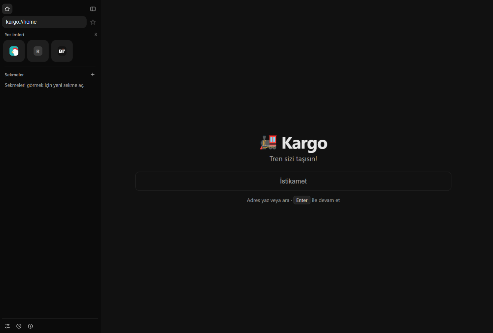
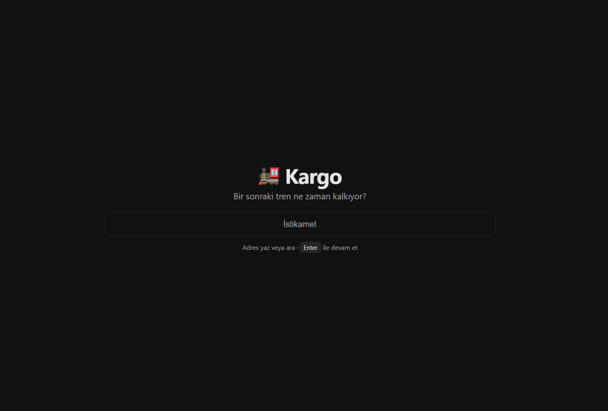
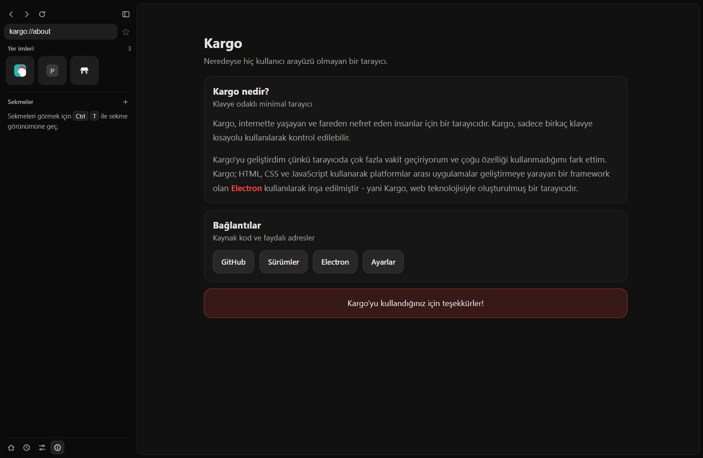

<p align="center">
  
  <h1 align="center">Kargo</h1>
</p>

<p align="center">
  Chromium tabanlı, klavye odaklı ve sade bir masaüstü tarayıcısı.
</p>

Kargo, web'de klavyeyle gezinmek ve gereksiz arayüz öğelerini azaltmak için tasarlanmış bir masaüstü tarayıcısıdır. Electron ve Chromium tabanlıdır; sekmeler, arama, geçmiş ve yer imleri gibi temel özelliklere odaklanır.

Proje geliştirme aşamasındadır. Denemek veya yüklemek için [en son sürümü](https://github.com/aardaakpinar/kargo/releases/latest) indirebilirsin.

## Geliştirme

Node.js ve npm kurulu bir ortamda:

```sh
npm install
npm run dev
```

Paket oluşturmak için `npm run build`; işletim sistemine özel paket için `npm run build:win`, `npm run build:mac` veya `npm run build:linux` kullan.

## Özellikler

- **Kenar çubuğunda sekmeler**: Sekmeleri ve Kargo'nun kendi sayfalarını aynı kenar çubuğundan yönet.
- **Arama ve gezinme**: `Ctrl + K` arama penceresini açar; boşken yakın zamanda ziyaret edilen sayfaları gösterir, yazarken arama ve geçmiş sonuçlarını sunar. `↑` ve `↓` ile sonuçları seç, `Enter` ile aç, `Esc` ile kapat.
- **Yer imleri**: `Ctrl + D` geçerli sayfayı ekler veya kaldırır. Yer imleri kenar çubuğunda listelenir; sürükleyerek sıralayabilirsin.
- **Geçmiş**: Ziyaret edilen sayfaları görüntüle, tek tek kaldır veya tüm geçmişi temizle.
- **Kısayolları özelleştirme**: Ayarlar sayfasında kısayol ata, tek bir kısayolu veya tümünü varsayılana döndür.
- **Diğerleri**: Açılır bağlantıları sekmede açma, Chromium geliştirici araçları, PDF görüntüleme ve HTML5 tam ekran desteği.
- **Sade tasarım**: Koyu ve açık tema, başlangıç sayfası, arama motoru, kenar çubuğu ve yakınlaştırma tercihleri.

## Ekran Görüntüleri

##### Windows üzerinde Kargo ana sayfası



##### Windows üzerinde Kargo'da bir web sayfası



##### Windows üzerinde Kargo hakkında sayfası



## Klavye Kısayolları

Varsayılan kısayolların tam listesi [Kargo web sitesinde](https://aardaakpinar.github.io/kargo/#shortcuts) yer alır. Uygulamada **Ayarlar → Kısayollar** bölümünden bir kısayola tıklayıp yeni tuş kombinasyonuna basarak değiştirebilirsin. `Esc` kaydı iptal eder; `↺` seçili kısayolu, **Varsayılanlara dön** tüm kısayolları sıfırlar. Özel atamalar `Ctrl` içerir; `F5` ve `F12` varsayılanları bu kuralın dışındadır.

## Gelecek

Kargo geliştirme aşamasındadır. Katkı ve hata bildirimleri için [GitHub deposunu](https://github.com/aardaakpinar/kargo) ziyaret edebilirsin.

## Lisans ve atıflar

Proje MIT lisanslıdır. Logo, [Twemoji](https://github.com/twitter/twemoji/blob/gh-pages/svg/1f682.svg) çalışmasından alınmış ve [CC BY 4.0](https://creativecommons.org/licenses/by/4.0/) lisansıyla kullanılmıştır.

MIT License © [Arda](https://aardaakpinar.github.io)
